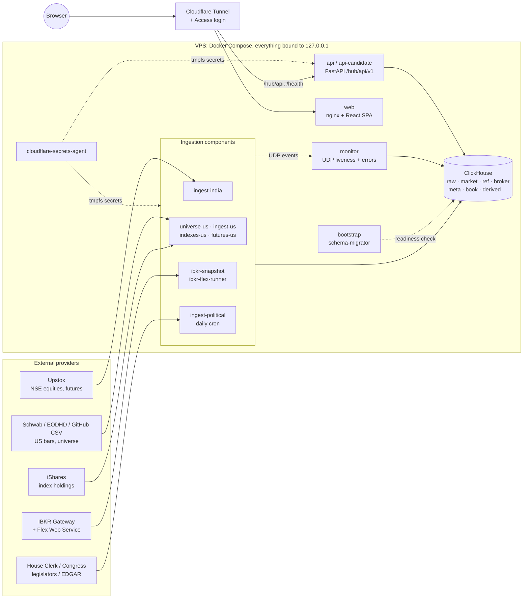

# FactorLab

FactorLab is a private, multi-source market research platform. It collects market,
broker, index and political-disclosure data from external providers. It stores raw
payloads and curated, point-in-time facts in ClickHouse, and serves them through a
FastAPI backend and a React "terminal" hub at `arjundoshi221.com` (behind Cloudflare
Access).

This page is the starting point for contributors: how the system fits together, how to
change it, and how changes reach production. Detailed docs are linked from each section.

- [Architecture](#architecture)
- [Repository layout](#repository-layout)
- [Getting started](#getting-started)
- [Everyday workflow](#everyday-workflow)
- [Editing existing containers and services](#editing-existing-containers-and-services)
- [Deploying](#deploying)
- [Creating something new](#creating-something-new)
- [Operating production](#operating-production)
- [Rules that are enforced](#rules-that-are-enforced)
- [Where to read more](#where-to-read-more)

---

## Architecture

### The big picture



### How data flows

1. **Provider** (`providers/<p>/`): vendor-specific code only. It handles auth, rate
   limits and fetching, and parses vendor payloads into canonical records. Providers may
   import only `core`, `calendars` and `ingest`.
2. **Ingest engine** (`libs/ingest`, `libs/orchestration`): runs a provider *binding* from
   [configs/ingestion/bindings.yaml](configs/ingestion/bindings.yaml) (which provider
   feeds which dataset, on what schedule), and records each run in
   `meta.ingestion_runs`.
3. **Storage** (`libs/storage`): canonical sinks. Every response is kept in
   `raw.archive` (raw retention is permanent and replayable). Curated rows go to
   `market.*`, `ref.*`, `broker.*`, etc., with lineage back to the raw row and the run.
4. **Serving**: `api` reads ClickHouse and exposes `/hub/api/v1/*`; `web` is a static
   SPA that calls only that API.

Two principles shape everything: **point-in-time correctness** (facts carry when they
happened and when we knew them; tables are mostly ReplacingMergeTree, read with `FINAL`)
and **vendor logic stays at the edge** (nothing outside `providers/` knows a vendor's
payload shape). See [docs/architecture/01-overview.md](docs/architecture/01-overview.md).

### Deployable units and their containers

Each folder in `components/` is one **unit**: its own image, manifest
(`component.yaml`), Dockerfile, compose fragment and changelog. A unit can run several
**services** (containers) from the same image.

| Unit | Services (containers) | What it does |
|---|---|---|
| `api` | `api`, `api-candidate` | FastAPI read API and hub backend (`/hub/api/v1/*`). |
| `web` | `web` | The hub UI: React + Vite, built to static files and served by non-root nginx on `:8080`. |
| `ingest-india` | `ingest-india` | NSE equities and stock futures from Upstox (intraday polling). |
| `ingest-us` | `universe-us`, `ingest-us`, `indexes-us`, `futures-us` | US universe resolution, daily and 1-minute bars (Schwab), sector indexes, futures quotes. |
| `ingest-broker` | `ibkr-snapshot`, `ibkr-flex-runner` | Read-only IBKR account mirror (positions, balances) and Flex statement history into `broker.*`. |
| `ingest-political` | `ingest-political` (daily cron) | Congressional references, House filing index and PTR trades. |
| `monitor` | `monitor` | Receives UDP heartbeats and errors from every service and alerts on silence ([deploy/monitor-services.yaml](deploy/monitor-services.yaml)). |
| `secrets-agent` | `cloudflare-secrets-agent` | Pulls secrets from Cloudflare Secrets Store and renders them into each consumer's tmpfs volume. |
| `schema-migrator` | `bootstrap` | One-shot ClickHouse readiness gate; runs reviewed, forward-only migrations (`factorlab-db`). |
| `platform` (`deploy/`) | `clickhouse`, `ibkr-gateway-paper`, `ibkr-gateway-live`, `uptime-kuma`, `portainer` | Compose base, host deployer and scripts, log rotation, systemd units. |

The generated file [deploy/compose.production.yml](deploy/compose.production.yml) is
the full service list. Never edit it by hand; it is rendered from the fragments.

**Networks:** `backend` (ClickHouse, writers, API) and `edge` (web). `web` cannot reach
ClickHouse.

**Edge and auth:** the VPS opens no public ports. An outbound Cloudflare Tunnel routes
`arjundoshi221.com` to the loopback ports, and **Cloudflare Access is the only login**.
There is no in-app auth, so nothing may ever bypass the tunnel. See
[deploy/edge/README.md](deploy/edge/README.md).

**API services:** `api` (port 8000) is the original service. `api-candidate` (port 18000)
is the one the automatic UI deploy replaces. Which of the two the tunnel routes
`/hub/api` to is set in the Cloudflare dashboard. Check [docs/VPS.md](docs/VPS.md) for
the current state before relying on either.

**Secrets:** never in the repo or in `.env` on the server. They are held in Cloudflare
Secrets Store and rendered by the secrets agent into per-service tmpfs. Upstox OAuth runs
through two Cloudflare Workers in [cloudflare/](cloudflare/).

### ClickHouse databases

| Database | Contents |
|---|---|
| `raw` | Every provider response, verbatim (`raw.archive`). Permanent. |
| `ref` | Reference data: instruments, listings, identifiers, universes. |
| `market` | Bars (daily and 1-minute), index levels, futures quotes. |
| `broker` | IBKR positions, balances, executions, orders, cash flows, statement rows. |
| `book` | Portfolio tagging and app profiles. |
| `meta` | Ingestion runs, expected series, service events and status, collection plan. |
| `alt`, `fundamentals`, `derived`, `research`, `risk` | Alternative data, fundamentals, computed series and research outputs. |

The schema is a sequence of **waves** in
[libs/schema/src/factorlab/schema/sql/clickhouse/v2/](libs/schema/src/factorlab/schema/sql/clickhouse/v2/),
frozen by checksum once applied. See
[docs/architecture/06-schema-rehau.md](docs/architecture/06-schema-rehau.md).

---

## Repository layout

One [uv](https://docs.astral.sh/uv/) workspace (Python 3.12) plus one npm project
(`components/web`, Node 22).

| Path | What lives there |
|---|---|
| `libs/` | Shared libraries `factorlab.<x>`: `core` (settings, secrets, logging), `runtime`, `calendars`, `clickhouse`, `schema`, `ingest`, `storage`, `orchestration`, `indexes`, `testkit` (dev only). |
| `providers/` | One package per data source `factorlab.sources.<p>`: `upstox`, `schwab`, `eodhd`, `github-csv`, `ishares`, `ibkr`, `house-clerk`, `congress-legislators`, `edgar`. |
| `components/` | Deployable units (see the table above). |
| `deploy/` | The platform unit: compose base, generated production compose, host scripts, deploy trials (`deploy/testing/`), release scripts. |
| `configs/` | Ingestion bindings, source settings, universes. No secrets. |
| `cloudflare/` | Cloudflare Workers for Upstox auth. |
| `tools/` | Repo tooling: `scaffold.py`, `components.py`, `release.py`, `check_docs.py`, `schema_checksums.py`, `read_logs.py`, `verify_image.py`. |
| `tests/` | Cross-cutting tests (architecture rules, deploy runners, tools). Each member's own tests live in its `tests/`. |
| `docs/` | Architecture, ADRs (`decisions/`), features and sprints, runbooks (`operations/`), data-source notes. |

Every library, provider, component and `deploy/` has a **`CONTEXT.md`**: what it owns,
its entry points, config, dependencies and gotchas. Read it before changing that
member, and update it in the same change. Full dependency rules:
[docs/architecture/08-repository-layout.md](docs/architecture/08-repository-layout.md).

---

## Getting started

```bash
git clone https://github.com/arjundoshi221/FactorLab.git && cd FactorLab
uv sync --all-packages                          # every member, editable, plus dev tools
uv run pre-commit install --install-hooks       # required: the hooks enforce repo policy
uv run pre-commit install --hook-type pre-push  # type check before push
git config blame.ignoreRevsFile .git-blame-ignore-revs
cd components/web && npm ci                     # hub UI
```

Check it works: `uv run pytest` (about 1,200 tests, roughly a minute) and
`npm test` in `components/web`.

Windows notes: if `uv` is not on `PATH` it is usually under
`%APPDATA%\Python\Python3xx\Scripts`. Some files are committed with CRLF; keep each
file's existing line endings so diffs stay small.

**Access to live data (optional):** reading production ClickHouse or tunnelling to the
API needs an SSH login on the VPS. Ask the owner, then follow
[docs/VPS.md](docs/VPS.md) ("ClickHouse workstation access"). Most work needs neither:
tests use fakes from `libs/testkit`, and UI tests stub `fetch`.

---

## Everyday workflow

`main` is the only long-lived branch. Keep branches short and push small, coherent
commits.

1. Read the `CONTEXT.md` of the member you are changing. For larger work, write a
   feature file in `docs/features/` from `_template.md`.
2. Make the change, with tests beside it (`<member>/tests/`).
3. Run the checks for what you touched:

   ```bash
   uv run pytest components/api            # or libs/storage, providers/ibkr, …
   uv run ruff check . && uv run ruff format --check .
   uv run basedpyright                     # strict on libs; new findings fail
   uv run python tools/components.py check # if you touched a manifest or compose fragment
   uv run python tools/check_docs.py --write   # if you touched docs/features, sprints, decisions
   cd components/web && npm test && npm run build   # if you touched the UI
   ```

4. Commit with a conventional message (`feat(web): …`, `fix(ingest-us): …`,
   `docs(vps): …`). Changelogs are built from these.
5. Push to `main` (or open a PR). CI's `ci-ok` is the single required check.

> Pushing API or web changes to `main` **deploys them to production** once CI is green.
> See [Deploying](#deploying).

---

## Editing existing containers and services

Find the service in the units table above, then open `components/<unit>/`. Every unit
has the same shape:

```
components/<unit>/
  CONTEXT.md            # read first: ownership, entry points, config, gotchas
  component.yaml        # manifest: services, health, secrets, rollback class
  Dockerfile            # built from the repo root
  deploy/compose.yaml   # compose fragment for its services
  src/factorlab/components/<unit>/   # code
  tests/
```

### The UI (`components/web`)

- Pages: `src/pages/`, routed by path in `src/App.tsx`. Shell, tabs and command bar:
  `src/shell/` (`nav.ts`). Charts: `src/shared/charts/`. Colours and spacing are tokens
  in `src/theme/tokens.css`; page CSS uses tokens, never raw hex.
- `/portfolio/*` is a separate, lazily loaded app with its own theme in `src/portfolio/`.
- Local dev:

  ```bash
  cd components/web
  npm run dev    # http://127.0.0.1:5173, proxies /hub/api to 127.0.0.1:8000
  npm test       # vitest; tests stub fetch, so no backend is needed
  ```

- For real data, run the API locally (below) or SSH-tunnel the VPS API to local port 8000
  (`ssh -L 8000:127.0.0.1:18000 …` for `api-candidate`; host details in
  [docs/VPS.md](docs/VPS.md)).
- Response types live in `src/`. Keep them in sync with the API models.

### The API (`components/api`)

- Routes and models: `src/factorlab/components/api/`. Add a test in `tests/` for every
  route.
- Run locally against production ClickHouse (read-only user, tunnel opened automatically
  when `CLICKHOUSE_SSH_HOST` is set in `.env`):

  ```bash
  uv run --env-file .env factorlab-api --host 127.0.0.1 --port 8000
  ```

### Ingestion services (`ingest-*`)

- Vendor logic belongs in `providers/<p>/`, not in the component. The component wires
  providers to bindings, schedules and sinks.
- Each has a CLI (`factorlab-ingest-us`, `factorlab-ingest-india`, …). Use
  `engine validate` to check bindings without touching data. Local runs read no `.env`
  implicitly: `uv run --env-file .env factorlab-ingest-us …`.
- Provider fixtures and conformance tests live in `providers/<p>/tests/`. Record new
  payload shapes there.
- A change that alters what gets written must keep raw lineage. For `writer` units, bump
  `data_contract` in `component.yaml`.

### Configuration, schedules and secrets

- Schedules, universes, provider choice: `configs/`. Silence deadlines for alerts:
  `deploy/monitor-services.yaml`.
- Environment for a service: its compose fragment (`components/<unit>/deploy/compose.yaml`),
  then `uv run python tools/components.py render-compose` to regenerate
  `deploy/compose.production.yml`. Document every new variable in `.env.example` (a
  hook checks this) and in the unit's `CONTEXT.md`.
- A new secret is added to Cloudflare Secrets Store and declared in the unit's
  `component.yaml` `secrets`. It never goes in the repo.

### Database changes

Add a new wave file (never edit an applied one) under
`libs/schema/.../sql/clickhouse/v2/`, then run
`uv run python tools/schema_checksums.py add`. Production migrations are a separate,
reviewed operation, run on the VPS **before** deploying code that needs them. No deploy
ever migrates.

---

## Deploying

Production runs on one VPS under Docker Compose. Until the per-component release
rollout finishes ([docs/operations/rollout.md](docs/operations/rollout.md)), every deploy
is a **CI-gated trial from `main`**. A workflow builds an immutable image
(`ghcr.io/arjundoshi221/factorlab-<unit>`), replaces only the targeted services on the
VPS, verifies them, and restores the previous images automatically if anything fails.

| What changed | How it deploys |
|---|---|
| `components/web`, `components/api`, `libs/`, `configs/`, `pyproject.toml`, `uv.lock` | **Automatically** on push to `main`, after CI is green: workflow *Branch UI trial release* replaces `api-candidate` then `web`. |
| An ingestion service | `./deploy/release-ui-trial.ps1 -Trial ingest -Scope <futures-us\|indexes-us\|ingest-us\|ingest-india\|ingest-broker>` |
| `monitor`, `secrets-agent`, `schema-migrator` | `./deploy/release-ui-trial.ps1 -Trial platform -Scope <monitor\|secrets-agent\|schema-migrator>` |
| `ingest-political` | `./deploy/release-ui-trial.ps1 -Trial political` (also runs the identity repair) |
| Redeploy the UI without a code change | `./deploy/release-ui-trial.ps1` |

Manual trials run in PowerShell from a **clean `main` that matches `origin/main`** with a
green CI. The script pushes an immutable tag (`<kind>-trial/…/<sha12>`) that starts the
workflow. Each commit deploys at most once per unit, so push a new commit to redeploy.

After any deploy, open GitHub → Actions → the workflow run. Its summary reports
verification and recovery. A run that only *started* is not a successful deploy. Record
production changes in [docs/VPS.md](docs/VPS.md).

Details, including what each trial verifies and how to restore manually:
[deploy/testing/README.md](deploy/testing/README.md). The target release model
(`./deploy/release.ps1 -Component <unit> -Bump patch`, `<unit>/vX.Y.Z` tags) is in
[docs/operations/releases.md](docs/operations/releases.md).

---

## Creating something new

Always use the scaffolder, never create members by hand. It wires the workspace, lock
file, compose rendering, log directories, log rotation and docs pointers.

### A new UI page

1. Add `src/pages/<Name>.tsx` (and `<Name>.test.tsx`) in `components/web`.
2. Route it in `src/App.tsx` and add it to the shell nav (`src/shell/nav.ts`).
3. If it needs data, add an API route (next section).
4. Push to `main`. It deploys automatically.

### A new API route

Add the route and its Pydantic model in `components/api`, with a test that uses the fake
ClickHouse from `libs/testkit`. Add the response type in `components/web/src/`. It
deploys with the UI.

### A new data provider

```bash
uv run python tools/scaffold.py new-provider <name> --dataset <dataset-id> --market <ISO3> \
  [--resolutions 1min,daily] --component <unit> [--bind] --summary "..."
```

Implement the provider contract from `libs/ingest`, add fixtures and conformance tests,
and add a binding in `configs/ingestion/bindings.yaml`. Guide:
[.claude/skills/new-provider/SKILL.md](.claude/skills/new-provider/SKILL.md).

### A new service in an existing unit (preferred)

When the new container shares a unit's code (for example `futures-us` in `ingest-us`):

1. Add it under `services:` in `components/<unit>/component.yaml` and to the unit's
   `deploy/compose.yaml`.
2. `uv run python tools/components.py render-compose`, then `tools/components.py check`.
3. Add its silence deadline to `deploy/monitor-services.yaml`.
4. Register it as a deploy scope (step 5 of the next section).

### A new unit (component)

Make a new unit only when the work needs a different runtime, release cadence or blast
radius.

1. **Scaffold:**

   ```bash
   uv run python tools/scaffold.py new-component <name> --summary "..." [--writer]
   ```

   Use `--writer` for anything that writes production data. It sets rollback class
   `writer` and `data_contract: 1`.
2. **Fill in** `component.yaml` (`services`, `health`, `secrets`), the compose fragment
   (ports bind `127.0.0.1` only, no privileged keys, bind mounts only under
   `/var/log/factorlab/`, `/var/lib/factorlab/app-data` or `/etc/factorlab/`, plus a
   memory limit), and `CONTEXT.md`.
3. **Check locally:**

   ```bash
   uv run pytest components/<name> tests/architecture tests/deploy
   uv run python tools/components.py check
   docker build -f components/<name>/Dockerfile -t factorlab-<name>:dev .
   uv run python tools/verify_image.py <name> factorlab-<name>:dev
   ```

   CI's image matrix picks the new Dockerfile up automatically.
4. **Monitoring and schema:** add it to `deploy/monitor-services.yaml`. If it writes new
   tables, add a schema wave and get it applied on the VPS first.
5. **Make it deployable.** Until per-component releases are live, register the scope in
   every one of these places. `futures-us` is a worked example; grep for it.
   - `deploy/testing/ingest_trial.py` → `UNITS` (or `deploy/testing/platform_trial.py`
     → `SCOPES` for a platform service);
   - `deploy/testing/ingestion_test.py` → `SERVICE_SCOPES`, if it is an extra service
     in another unit's image;
   - the tag regex in `.github/workflows/branch-ingest-deploy.yml` (or
     `branch-platform-deploy.yml`);
   - the `-Scope` lists in `deploy/release-ui-trial.ps1`;
   - a test beside `tests/deploy/test_ingest_trial.py`.
6. Push to `main`. Once CI is green, run
   `./deploy/release-ui-trial.ps1 -Trial ingest -Scope <name>`.

Full checklist: [.claude/skills/new-component/SKILL.md](.claude/skills/new-component/SKILL.md).

### A new library

`uv run python tools/scaffold.py new-lib <name>`. Libraries must not import components
or providers (enforced by `tests/architecture`).

---

## Operating production

These need VPS access and are run on request, never as a side effect of development.

| Task | How |
|---|---|
| Query live data | `uv run python scripts/read_clickhouse.py --sql "SELECT …"` (read-only, results capped) |
| Read service logs | `uv run python tools/read_logs.py list \| tail \| errors \| run --run-id …` through the restricted `factorlab-logs` account ([docs/operations/log-access.md](docs/operations/log-access.md)) |
| Service health | Hub → Ops → Monitoring (from the `monitor` service), and Uptime Kuma |
| Roll back a trial | The workflow summary prints the exact `… restore <test-id>` command |
| VPS state and history | [docs/VPS.md](docs/VPS.md), updated with every production change |
| Incidents and runbooks | [docs/operations/](docs/operations/), for example `clickhouse-memory.md` and `ibkr-gateway-setup.md` |

---

## Rules that are enforced

Pre-commit hooks and CI block these mechanically, so don't bypass them (`--no-verify`):

- No `.env*`, `data/`, `logs/`, credentials, private keys or plaintext tokens in commits.
- Applied schema waves are frozen. Change the schema only with a new wave.
- `deploy/compose.production.yml` must match the fragments, and manifests must be consistent.
- Architecture boundaries: providers import only `core`, `calendars` and `ingest`;
  libraries never import components.
- Docs indexes and `CONTEXT.md` files must be current.
- Never expose ClickHouse, the API or the hub on a public port. Cloudflare Access is the
  only authentication.
- Scratch work goes in the ignored `.tmp/<task>/` folder and is removed when done.

---

## Where to read more

| Topic | Doc |
|---|---|
| Contributor policies and hooks | [docs/CONTRIBUTING.md](docs/CONTRIBUTING.md) |
| Agent and Claude Code instructions | [AGENTS.md](AGENTS.md), [CLAUDE.md](CLAUDE.md) |
| Architecture and layout | [docs/architecture/](docs/architecture/) |
| Decisions (ADRs) | [docs/decisions/](docs/decisions/) |
| Features, roadmap, sprints | [docs/features/](docs/features/), [docs/sprints/](docs/sprints/) |
| API reference | [docs/API.md](docs/API.md) |
| Deploy and server operations | [deploy/README.md](deploy/README.md), [deploy/testing/README.md](deploy/testing/README.md) |
| VPS topology and state | [docs/VPS.md](docs/VPS.md) |
| Environment variables | [docs/operations/env-reference.md](docs/operations/env-reference.md) |
| Data sources | [docs/data-sources/](docs/data-sources/) |
